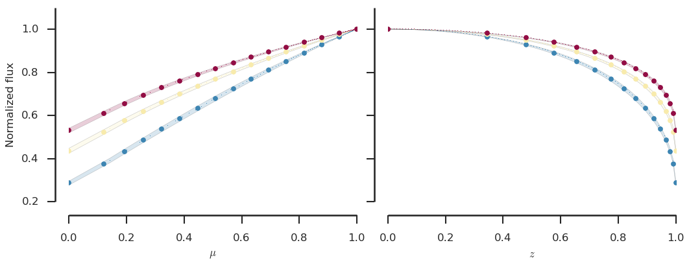
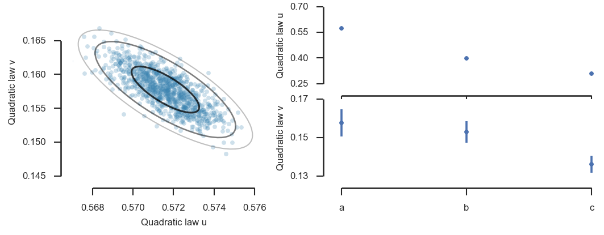
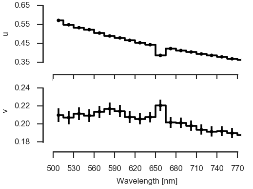

# LDTk

[](https://pypi.org/project/ldtk/)
[](https://ldtk.readthedocs.io/en/stable/)
[](http://www.gnu.org/licenses/gpl-2.0.html)
[](https://doi.org/10.1093/mnras/stv1857)
[](https://arxiv.org/abs/1508.02634)
[](https://ascl.net/1510.003)
[](https://zenodo.org/badge/latestdoi/5871/hpparvi/ldtk)
[](https://www.astropy.org/)

Python **L**imb **D**arkening **T**ool**k**it - a Python toolkit for calculating stellar limb darkening profiles and model-specific coefficients for arbitrary passbands using the stellar spectrum model library by Husser et al (2013).

```python
from ldtk import LDPSetCreator, BoxcarFilter

filters = [BoxcarFilter('a', 450, 550),  # Define your passbands
           BoxcarFilter('b', 650, 750),  # - Boxcar filters useful in
           BoxcarFilter('c', 850, 950)]  #   transmission spectroscopy

sc = LDPSetCreator(teff=(6400,   50),    # Define your star, and the code
                   logg=(4.50, 0.20),    # downloads the uncached stellar
                      z=(0.25, 0.05),    # spectra from the Husser et al.
                     filters=filters)    # server automatically.

ps = sc.create_profiles()                # Create the limb darkening profiles
cq,eq = ps.coeffs_qd(do_mc=True)         # Estimate quadratic law coefficients

lnlike = ps.lnlike_qd([[0.45,0.15],      # Calculate the quadratic law log
                       [0.35,0.10],      # likelihood for a set of coefficients
                       [0.25,0.05]])     # (returns the joint likelihood)

lnlike = ps.lnlike_qd([0.25,0.05],flt=0) # Quad. law log L for the first filter
```




...and the same, but for 19 narrow passbands...



## Overview

LDTk automates the calculation of custom stellar limb darkening (LD) profiles and model-specific limb darkening coefficients (LDC) using the library of PHOENIX-generated specific intensity spectra by Husser et al. (2013).

The aim of the package is to facilitate exoplanet transit light curve modeling, especially transmission
spectroscopy where the modeling is carried out for custom narrow passbands. The package can be

1. used to construct model-specific priors on the limb darkening coefficients prior to the transit light curve modeling
2. directly integrated into the log posterior computation of any pre-existing transit modeling code with minimal modifications.

The second approach can be used to constrain the LD model parameter space directly by the LD profile, allowing for the marginalization over the whole parameter space that can explain the profile without the need to approximate this constraint by a prior distribution. This is useful when using a high-order limb darkening model where the coefficients are often correlated, and the priors estimated from the tabulated values usually fail to include these correlations.

## What's new in 1.9

- **A more realistic likelihood.** The log-likelihood now accounts for the strong correlations between the mu
  points of the limb darkening profiles. The coefficient uncertainties are noticeably wider than in earlier
  versions, and they are largely insensitive to how finely the profiles are sampled.
- **Smooth grid interpolation.** The profiles are interpolated over the PHOENIX model grid with radial basis
  functions instead of piecewise-linear interpolation.

See [CHANGES.md](CHANGES.md) for the full history and how to restore the old behavior.

## Requirements

- Python 3.8 or newer

## Installation

Use `pip`

    pip install [--upgrade] ldtk

or clone the source from GitHub and install it in editable mode

```bash
git clone https://github.com/hpparvi/ldtk.git
cd ldtk
pip install -e ".[test]"   # the test extra installs pytest
pytest tests
```

## Documentation

The full documentation, including a quickstart guide, the filter and likelihood guides, and the API reference,
is available at [ldtk.readthedocs.io](https://ldtk.readthedocs.io/en/latest/).

## Citing

If you use LDTk in your research, please cite the LDTk paper

    Parviainen, H. & Aigrain, S. MNRAS 453, 3821–3826 (2015) (DOI:10.1093/mnras/stv1857).

and the paper describing the spectrum library without which LDTk would be rather useless

    Husser, T.-O. et al. A&A 553, A6 (2013) (DOI:10.1051/0004-6361/201219058).

or use these ready made BibTeX entries

    @article{Parviainen2015,
      author = {Parviainen, Hannu and Aigrain, Suzanne},
      doi = {10.1093/mnras/stv1857},
      journal = {MNRAS},
      month = nov,
      number = {4},
      pages = {3821--3826},
      title = {{ldtk: Limb Darkening Toolkit}},
      url = {http://mnras.oxfordjournals.org/lookup/doi/10.1093/mnras/stv1857},
      volume = {453},
      year = {2015}
    }

    @article{Husser2013,
      author = {Husser, T.-O. and {Wende-von Berg}, S and Dreizler, S and Homeier, D and
                 Reiners, A and Barman, T. and Hauschildt, Peter H},
      doi = {10.1051/0004-6361/201219058},
      journal = {A{\&}A},
      pages = {A6},
      title = {{Astrophysics A new extensive library of PHOENIX stellar atmospheres}},
      volume = {553},
      year = {2013}
    }

## Author

[Hannu Parviainen](https://github.com/hpparvi), Instituto de Astrofísica de Canarias

## Contributors

- Rainer Wichmann, Hamburger Sternwarte, Universität Hamburg
- [Tom Louden](https://github.com/tomlouden), University of Warwick
- [Ian Crossfield](https://github.com/iancrossfield), University of Arizona
- Kirstin Hay
- Tamim Fatahi
- John Engelke
- Akshay Priyadarshi

--

Copyright © 2015–2026 Hannu Parviainen <hpparvi@gmail.com>
